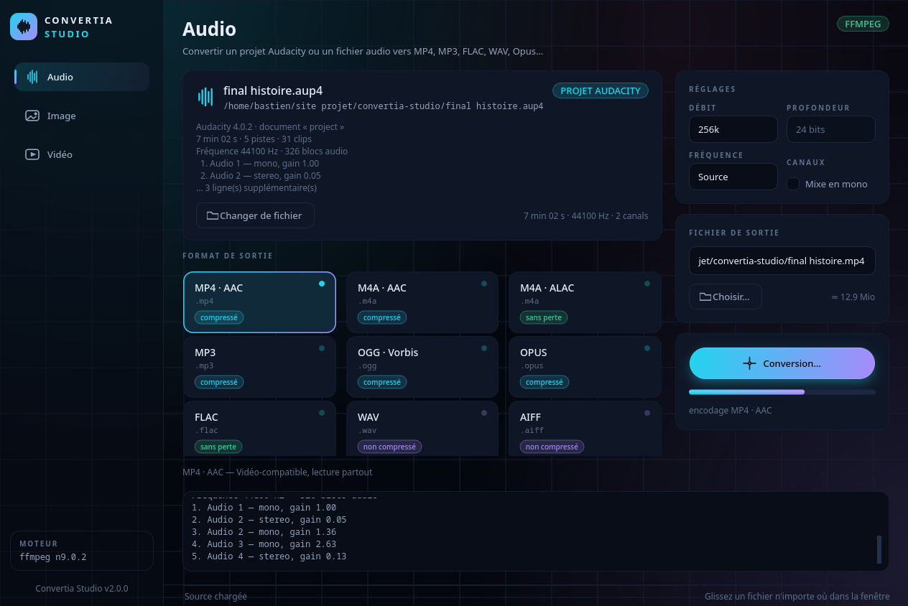

# Convertia Studio

Application de conversion de médias, avec interface graphique moderne et ligne
de commande. Côté **audio**, elle convertit les **projets Audacity** (`.aup3`,
`.aup4`, y compris les fichiers `*unsaved`) et **n'importe quel fichier audio**
vers neuf formats de sortie — sans lancer Audacity. Côté **image**, elle
recadre, redimensionne, pivote et compresse les images (PNG, JPEG, WebP, AVIF,
TIFF, BMP) avec aperçu et comparaison du poids avant / après.

> **Section à venir** : la partie « Vidéo » est déjà présente dans la
> navigation et attend son contenu (voir
> [Étendre l'application](#étendre-lapplication)).



<sub>La section Image est disponible : [aperçu](docs/apercu-image.png) · la
section Vidéo reste à définir : [aperçu](docs/apercu-video.png).</sub>

## Télécharger (Windows)

Les versions prêtes à l'emploi sont publiées dans les
[**Releases GitHub**](../../releases/latest) :

1. télécharger `ConvertiaStudio-win64.zip` ;
2. décompresser l'archive où tu veux (le dossier `ConvertiaStudio/`) ;
3. double-cliquer sur `ConvertiaStudio.exe`.

Rien à installer : Python, Qt, Pillow, ffmpeg et ffprobe sont inclus dans
l'archive.
Windows peut afficher un avertissement SmartScreen, l'exécutable n'étant pas
signé : *Informations complémentaires* → *Exécuter quand même*. Les empreintes
SHA-256 sont fournies dans `SHA256SUMS.txt` à côté de l'archive.

## Démarrage rapide

| Plateforme | Lancement |
| --- | --- |
| Windows | `ConvertiaStudio.exe` (archive `ConvertiaStudio-win64.zip` des Releases) |
| Linux / macOS | `python3 convertia_studio.pyw` |
| Ligne de commande | `python3 -m convertia_studio --help` |

Ce qui est nécessaire :

- Python 3.10+ et `numpy` ;
- `PySide6` pour l'interface graphique ;
- `Pillow` pour le traitement d'images ;
- `ffmpeg` pour les formats audio compressés (MP3, MP4, Opus…). Sous Windows,
  `ffmpeg.exe` est livré dans `bin/` à côté de l'exécutable.

## Formats

### Audio

**En entrée** : projets Audacity `.aup3` / `.aup4` (et `*unsaved`), ou tout
fichier audio ou vidéo contenant de l'audio (WAV, MP3, M4A, FLAC, OGG, Opus,
AIFF, WMA, MP4, MKV, WebM…).

**En sortie** :

| Format | Extension | Type | Réglages |
| --- | --- | --- | --- |
| MP4 · AAC | `.mp4` | compressé | débit (96k → 320k) |
| M4A · AAC | `.m4a` | compressé | débit |
| M4A · ALAC | `.m4a` | sans perte | — |
| MP3 | `.mp3` | compressé | débit |
| OGG · Vorbis | `.ogg` | compressé | débit |
| OPUS | `.opus` | compressé | débit |
| FLAC | `.flac` | sans perte | compression maximale |
| WAV | `.wav` | non compressé | 16 / 24 bits, 32 bits flottant |
| AIFF | `.aiff` | non compressé | 16 / 24 bits, 32 bits flottant |

Tous les formats acceptent une fréquence de sortie imposée (44,1 / 48 / 96 kHz)
et un mixage mono.

### Image

**En entrée** : PNG, JPEG, WebP, AVIF, TIFF, BMP, GIF, ICO (et la plupart des
formats lus par Pillow). L'orientation EXIF est appliquée à l'ouverture ; seule
la première image d'un GIF ou d'un WebP animé est conservée.

| Format | Extension | Type | Réglages |
| --- | --- | --- | --- |
| JPEG | `.jpg` | compressé | qualité 1 → 100 |
| WebP | `.webp` | compressé | qualité, transparence |
| AVIF | `.avif` | compressé | qualité (encodage plus lent) |
| PNG | `.png` | sans perte | transparence, optimisation |
| TIFF | `.tiff` | sans perte | compression deflate |
| BMP | `.bmp` | brut | — |

Transformations disponibles, appliquées dans cet ordre : **recadrage**
(sélection à la souris), **rotation** (90° / 180°), **miroir** et
**redimensionnement** (avec conservation des proportions). La page affiche un
aperçu du résultat, le poids estimé et l'écart avant / après ; la transparence
est aplatie sur fond blanc pour les formats qui ne la gèrent pas.

## Ligne de commande

```bash
# projet Audacity → MP4 (même nom, à côté du projet)
python3 -m convertia_studio "mon projet.aup4"

# vers MP3 à 320 kb/s, en écrasant la sortie précédente
python3 -m convertia_studio projet.aup4 -f mp3 -b 320k -o podcast.mp3 --force

# n'importe quel fichier audio → Opus mono 64 kb/s
python3 -m convertia_studio interview.wav -f opus -b 64k --mono

# image → WebP 70 %, recadrée, tournée et réduite
python3 -m convertia_studio photo.png -f webp -Q 70 \
    --crop 100,50,1200,800 --rotate 90 --resize 800x600 -o photo.webp

# analyser une source sans convertir
python3 -m convertia_studio "mon projet.aup4" --info

# lister les formats disponibles
python3 -m convertia_studio --list-formats
python3 -m convertia_studio --list-image-formats
```

Options audio : `-b/--bitrate`, `--depth`, `--sample-rate`, `--mono`.
Options image : `-Q/--quality`, `--resize`, `--crop`, `--rotate`, `--flip-h`,
`--flip-v`. Options communes : `-o/--output`, `-f/--format`, `--info`,
`--list-formats`, `--list-image-formats`, `-q/--quiet`, `--force`, `--version`.

Depuis l'exécutable Windows (compilé sans console), la ligne de commande reste
accessible en préfixant par `--cli` :

```bat
ConvertiaStudio.exe --cli "C:\projets\mon projet.aup4" -f flac --force
ConvertiaStudio.exe --cli "C:\photos\portrait.jpg" -f webp -Q 75 --resize 50%%
```

## Ce que le mixage restitue

Pour un projet Audacity, l'outil reproduit ce que contient le fichier :

- position et chevauchement des clips (`offset`, `trimLeft`, `trimRight`) ;
- gain de piste et panoramique (loi linéaire d'Audacity, sans atténuation au
  centre), états muet et solo ;
- enveloppes de volume (fade in/out) ;
- pistes mono dupliquées sur les deux canaux, pistes stéréo canal par canal ;
- blocs audio 16 bits, 24 bits et float 32 bits ;
- étirement de clips (`clipStretchRatio`) : traité avec `rubberband`, repli sur
  `atempo`, puis interpolation linéaire en dernier recours — un avertissement
  s'affiche dans le journal ;
- lecture du journal WAL quand le projet est (ou a été) ouvert dans Audacity :
  le projet est copié dans un dossier temporaire pour lire un état cohérent.

## Traitement des images

- transformations appliquées dans cet ordre : recadrage, rotation, miroir,
  redimensionnement (rééchantillonnage Lanczos) ;
- orientation EXIF appliquée à l'ouverture, puis retirée du fichier produit ;
- profil ICC conservé pour JPEG, PNG, WebP et AVIF ;
- transparence conservée (PNG, WebP, AVIF, TIFF) ou aplatie sur fond blanc
  (JPEG, BMP) ;
- les métadonnées EXIF (appareil, date…) ne sont pas recopiées ;
- GIF et WebP animés : seule la première image est convertie ;
- images de plus de 8 bits par canal ramenées à 8 bits.

## Ce qui n'est pas restitué (audio)

- **Effets temps réel** d'Audacity : ils ne sont pas stockés dans le projet
  (seul l'audio d'origine l'est). Pour les inclure : `Fichier → Exporter` dans
  Audacity.
- **Pistes tempo** (`timetrack`) et étiquettes (`labeltrack`) : ignorées.
- **Dithering** : aucune mise en forme du bruit à la conversion 16/24 bits.
- Les crêtes au-delà de 0 dBFS sont écrêtées (sauf WAV/AIFF 32 bits flottant,
  qui conservent le signal tel quel).

## Structure du projet

| Chemin | Rôle |
| --- | --- |
| `convertia_studio/audio/project.py` | décodeur des projets Audacity + mixage |
| `convertia_studio/audio/formats.py` | registre des formats, encodage, écriture WAV/AIFF |
| `convertia_studio/image/engine.py` | transformations et encodage des images (Pillow) |
| `convertia_studio/image/formats.py` | registre des formats d'image |
| `convertia_studio/jobs.py` | analyse d'une source audio et orchestration de la conversion |
| `convertia_studio/ffmpeg_tools.py` | localisation de ffmpeg / ffprobe, analyse des médias |
| `convertia_studio/cli.py` | ligne de commande |
| `convertia_studio/gui/` | interface PySide6 (`app`, `window`, `widgets`, `theme`, `pages/`, `crop_dialog.py`) |
| `convertia_studio.pyw` | lanceur (fenêtre, ou `--cli` pour la console) |
| `tests/` | tests unitaires + générateur de projets Audacity de test |
| `build/` | recettes PyInstaller, icône, scripts de compilation |
| `scripts/publish_github.sh` | création du dépôt distant et envoi du code |
| `.github/workflows/build.yml` | compilation automatique (Windows + Linux) |
| `dist/` | application compilée (générée) |

## Étendre l'application

La navigation et la structure sont prêtes pour de nouvelles sections :

La section Image sert d'exemple complet.

1. créer une page dans `convertia_studio/gui/pages/` (voir `coming_soon.py`) ;
2. ajouter l'entrée dans `Sidebar.ENTRIES` et le `QStackedWidget` de
   `MainWindow` ;
3. placer la logique métier dans un module dédié (`convertia_studio/video/`)
   et l'exposer comme `image/engine.py` le fait pour les images.

## Publier une version

Le dépôt distant et la CI sont déjà en place. Pour publier une nouvelle
version téléchargeable (Release GitHub avec l'exécutable Windows) :

```bash
# 1. mettre à jour __version__ dans convertia_studio/__init__.py et CHANGELOG.md
# 2. committer, puis étiqueter et pousser (le tag déclenche la compilation)
git add -A && git commit -m "Convertia Studio 2.0.1"
./scripts/release.sh v2.0.1
```

`scripts/release.sh` vérifie que l'arbre est propre et que l'étiquette
correspond à `__version__`, puis pousse le tag. Le workflow
`.github/workflows/build.yml` compile alors sous Windows et Linux, assemble
`ConvertiaStudio-win64.zip`, calcule les empreintes SHA-256 et crée la Release.
La compilation peut aussi être lancée à la main depuis l'onglet « Actions »,
sans publication (les archives restent des artefacts).

## Compiler

```bash
# Linux (dossier dist/ConvertiaStudio/ avec ffmpeg copié à côté)
./build/build_linux.sh

# Windows, sur une machine Windows
build\build_windows.bat

# Windows, depuis Linux via Wine (ce qui a produit dist/ConvertiaStudio-win64/)
./build/win/build_exe_wine.sh

# GitHub Actions (Windows + Linux + Release) : .github/workflows/build.yml
```

## Tests

```bash
python3 -m unittest discover -s tests -t . -v
```

Les tests fabriquent leurs propres projets `.aup4` (via `tests/make_project.py`)
et vérifient le décodage, le mixage (gain, panoramique, mute/solo, enveloppes,
rognage, ancien format stéréo 3.0-3.3, blocs 16/24 bits), les écrivains
WAV/AIFF et la conversion complète.

## Dépannage

| Message | Cause / solution |
| --- | --- |
| « ffmpeg introuvable » | installer ffmpeg, ou le placer dans `bin/` à côté de l'application |
| « journal WAL détecté » | le projet est ouvert dans Audacity ; enregistrer puis fermer pour un instantané stable |
| « document principal vide : lecture de la sauvegarde automatique » | projet jamais enregistré (`.aup4unsaved`) |
| « bloc audio absent de la base » | projet incomplet ou corrompu : le passage devient silencieux |
| « crête à X : écrêtage » | baisser le gain des pistes dans Audacity, ou exporter en WAV 32 bits flottant |

## Licences

- Le code de Convertia Studio : licence MIT (voir `LICENSE`).
- `Pillow` (traitement d'images) : licence MIT-CMU ; le support AVIF dépend de
  libavif (licence BSD).
- `ffmpeg` embarqué dans la distribution Windows : binaires fournis par
  [gyan.dev](https://www.gyan.dev/ffmpeg/builds/), sous licence LGPL/GPL selon
  les codecs activés. Redistribuer l'exécutable implique de conserver la
  mention de licence d'origine.
