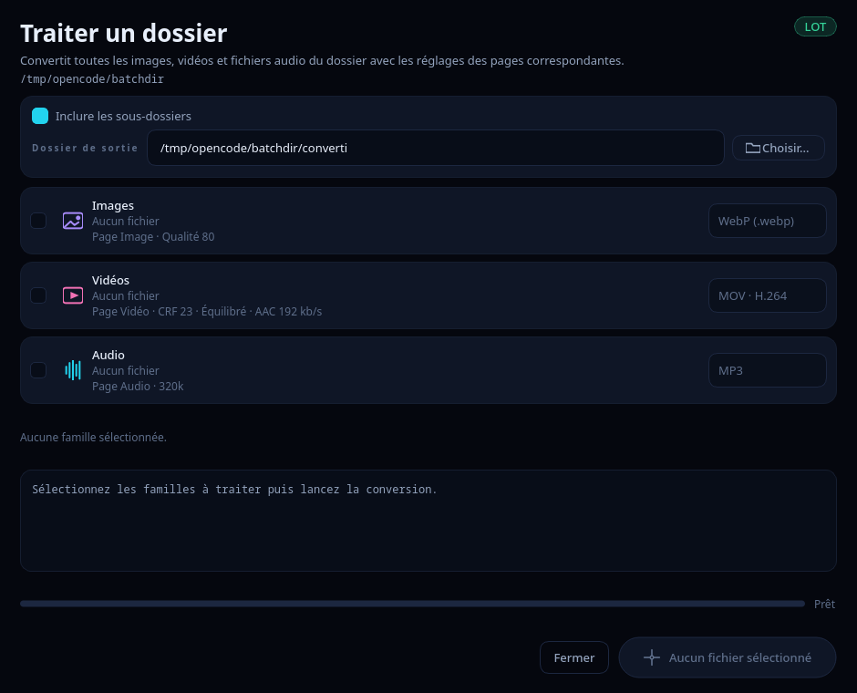

# Convertia Studio

Application de conversion de médias, avec interface graphique moderne et ligne
de commande. Côté **audio**, elle convertit les **projets Audacity** (`.aup3`,
`.aup4`, y compris les fichiers `*unsaved`) et **n'importe quel fichier audio**
vers neuf formats de sortie — sans lancer Audacity. Côté **image**, elle
recadre, redimensionne, pivote et compresse les images (PNG, JPEG, WebP,
HEIC, AVIF, TIFF, BMP, RAW) avec aperçu et comparaison du poids avant / après. Côté **vidéo**,
elle découpe, redimensionne, change la cadence, la vitesse et l'audio, puis
compresse en MP4 (H.264 / H.265), MOV, WebM (VP9) ou MKV, avec vignette de
contrôle et poids estimé.


<sub>Les trois sections sont disponibles :
[Audio](docs/apercu-audio.png) · [Image](docs/apercu-image.png) ·
[Vidéo](docs/apercu-video.png) · [Traitement d'un dossier](docs/apercu-lot.png).</sub>

## Télécharger (Windows)

Les versions prêtes à l'emploi sont publiées dans les
[**Releases GitHub**](../../releases/latest) :

1. télécharger `ConvertiaStudio-win64.zip` ;
2. décompresser l'archive où tu veux (le dossier `ConvertiaStudio/`) ;
3. double-cliquer sur `ConvertiaStudio.exe`.

Rien à installer : Python, Qt, Pillow, pillow-heif, rawpy, ffmpeg et ffprobe
sont inclus dans l'archive.
Windows peut afficher un avertissement SmartScreen, l'exécutable n'étant pas
signé : *Informations complémentaires* → *Exécuter quand même*. Les empreintes
SHA-256 sont fournies dans `SHA256SUMS.txt` à côté de l'archive.

## Télécharger (Linux)

L'archive `ConvertiaStudio-linux.tar.gz` des
[**Releases GitHub**](../../releases/latest) contient un lanceur :

```bash
tar xzf ConvertiaStudio-linux.tar.gz
./ConvertiaStudio/ConvertiaStudio.sh
```

Au premier lancement, `ConvertiaStudio.sh` vérifie les bibliothèques Qt
(xcb-cursor, xcb-icccm, xkbcommon-x11, OpenGL/EGL, fontconfig, dbus…). Si des
paquets manquent, il détecte la distribution et propose de les installer avec
`apt`, `dnf`, `pacman` ou `zypper` (mot de passe demandé via `sudo` ou
`pkexec`), puis démarre l'application.

- `./ConvertiaStudio.sh --check` : diagnostic seul, sans installation ;
- `CONVERTIA_NO_INSTALL=1 ./ConvertiaStudio.sh` : ne rien installer ;
- si la distribution est trop ancienne (glibc), un message l'indique.

L'exécutable `ConvertiaStudio` peut aussi être lancé directement lorsque les
dépendances sont déjà présentes.

## Démarrage rapide

| Plateforme | Lancement |
| --- | --- |
| Windows | `ConvertiaStudio.exe` (archive `ConvertiaStudio-win64.zip` des Releases) |
| Linux (archive) | `./ConvertiaStudio.sh` (archive `ConvertiaStudio-linux.tar.gz`) |
| Linux / macOS (sources) | `python3 convertia_studio.pyw` |
| Ligne de commande | `python3 -m convertia_studio --help` |

Ce qui est nécessaire :

- Python 3.10+ et `numpy` ;
- `PySide6` pour l'interface graphique ;
- `Pillow` pour le traitement d'images, `pillow-heif` pour HEIC/HEIF et
  `rawpy` pour les fichiers RAW ;
- `ffmpeg` pour les formats audio compressés (MP3, MP4, Opus…), les vidéos et
  l'analyse des médias. Sous Windows et dans l'archive Linux, des binaires
  autonomes sont livrés dans `bin/` à côté de l'exécutable ; à défaut, le
  `ffmpeg` du `PATH` est utilisé.

## Formats

### Audio

**En entrée** : projets Audacity `.aup3` / `.aup4` (et `*unsaved`), ou tout
fichier audio ou vidéo contenant de l'audio (WAV, MP3, M4A, FLAC, OGG, Opus,
AIFF, WMA, MP4, MKV, WebM…).

**En sortie** :

| Format | Extension | Type | Réglages |
| --- | --- | --- | --- |
| MP4 · AAC | `.mp4` | compressé | débit (96k → 320k) |
| M4A · AAC | `.m4a` | compressé | débit |
| M4A · ALAC | `.m4a` | sans perte | — |
| MP3 | `.mp3` | compressé | débit |
| OGG · Vorbis | `.ogg` | compressé | débit |
| OPUS | `.opus` | compressé | débit |
| FLAC | `.flac` | sans perte | compression maximale |
| WAV | `.wav` | non compressé | 16 / 24 bits, 32 bits flottant |
| AIFF | `.aiff` | non compressé | 16 / 24 bits, 32 bits flottant |

Tous les formats acceptent une fréquence de sortie imposée (44,1 / 48 / 96 kHz)
et un mixage mono.

### Image

**En entrée** : PNG, JPEG, WebP, HEIC/HEIF, AVIF, TIFF, BMP, GIF, ICO, ainsi
que les RAW d'appareil photo (`.raw`, `.dng`, `.cr2`, `.cr3`, `.nef`, `.arw`,
`.orf`, `.rw2`, `.raf`, `.srw`, `.pef`, `.kdc`…). L'orientation EXIF est
appliquée à l'ouverture ; seule la première image d'un GIF ou d'un WebP animé
est conservée. Les RAW sont décodés par LibRaw avec la balance des blancs de
l'appareil.

| Format | Extension | Type | Réglages |
| --- | --- | --- | --- |
| JPEG | `.jpg` | compressé | qualité 1 → 100 |
| WebP | `.webp` | compressé | qualité, transparence |
| HEIC | `.heic` | compressé | qualité, transparence (Apple) |
| AVIF | `.avif` | compressé | qualité (encodage plus lent) |
| PNG | `.png` | sans perte | transparence, optimisation |
| TIFF | `.tiff` | sans perte | compression deflate |
| BMP | `.bmp` | brut | — |

Transformations disponibles, appliquées dans cet ordre : **recadrage**
(sélection à la souris), **rotation** (90° / 180°), **miroir** et
**redimensionnement**. La taille se choisit dans un panneau déroulant
(**Originale**, **HD**, **Full HD**, **2K**, **Ultra HD 4K**, **8K**,
**Carré**, **Portrait**) ou en **Personnalisé** pour saisir ses dimensions.
Les préréglages ajustent l'image dans le cadre en conservant ses proportions.

La page affiche un aperçu du résultat (encodé aux réglages choisis, artefacts
de compression compris), le poids estimé et l'écart avant / après ; la
transparence est aplatie sur fond blanc pour les formats qui ne la gèrent pas.

### Vidéo

**En entrée** : MP4, M4V, MKV, WebM, MOV, AVI, WMV, FLV, MPG, TS, M2TS, 3GP,
OGV… La piste vidéo est détectée par ffprobe ; un MP4 sans piste vidéo reste
traité comme de l'audio.

| Format | Extension | Codecs | Réglages |
| --- | --- | --- | --- |
| MP4 · H.264 | `.mp4` | H.264 + AAC | CRF, cadence, résolution, audio |
| MP4 · H.265 | `.mp4` | H.265 + AAC | plus compact, liseurs récents |
| MOV · H.264 | `.mov` | H.264 + AAC | QuickTime, Apple et montage |
| WebM · VP9 | `.webm` | VP9 + Opus | ouvert, idéal pour le web |
| MKV · H.264 | `.mkv` | H.264 + AAC | conteneur souple |

Chaque conversion peut **découper un extrait** (début / fin, positionnables
depuis la vignette), **redimensionner** (préréglages HD → 8K, portrait, carré,
ou dimensions personnalisées, avec bandes noires ou rognage), changer la
**cadence** (24 → 60 i/s), la **rotation** (90° / 180°), la **vitesse**
(0,5× → 2×) et l'**audio** (AAC ou Opus, copie sans réencodage, suppression).
La page montre une vignette à la position choisie, le poids estimé avant /
après et permet d'**extraire l'image courante** en PNG.

## Traiter un dossier

Le bouton **« Traiter un dossier… »** de la barre latérale (ou le
glisser-déposer d'un dossier sur la fenêtre) ouvre le traitement par lot :



1. le dossier est analysé et ses fichiers classés en **images**, **vidéos** et
   **audio** (option *Inclure les sous-dossiers*) ;
2. chaque famille affiche son nombre de fichiers, son poids et son format de
   sortie, modifiable ; les autres réglages sont repris des pages : qualité
   d'image, CRF / vitesse / audio de la vidéo, débit et profondeur de l'audio ;
3. le dossier de sortie est libre (par défaut `<dossier>/converti`), et
   l'arborescence est conservée ;
4. la conversion s'enchaîne fichier par fichier avec la progression, le
   journal, l'annulation et un bilan (convertis / échecs).

Les fichiers source ne sont jamais écrasés : en cas de nom déjà pris, un
suffixe `-2`, `-3`… est ajouté. Les extensions inconnues sont ignorées et
signalées. Pour extraire la piste audio d'une vidéo, utiliser la page Audio
(un fichier `.mp4` est classé comme vidéo dans le lot).

## Ligne de commande

```bash
# projet Audacity → MP4 (même nom, à côté du projet)
python3 -m convertia_studio "mon projet.aup4"

# vers MP3 à 320 kb/s, en écrasant la sortie précédente
python3 -m convertia_studio projet.aup4 -f mp3 -b 320k -o podcast.mp3 --force

# n'importe quel fichier audio → Opus mono 64 kb/s
python3 -m convertia_studio interview.wav -f opus -b 64k --mono

# image → WebP 70 %, recadrée, tournée et réduite
python3 -m convertia_studio photo.png -f webp -Q 70 \
    --crop 100,50,1200,800 --rotate 90 --resize 800x600 -o photo.webp

# vidéo : extrait de 1:20 à 2:05 en Full HD
python3 -m convertia_studio --video film.mkv -f mp4 \
    --start 1:20 --end 2:05 --resize 1920x1080 -o extrait.mp4

# vidéo → WebM sans audio, cadence 30 i/s et vitesse 1,5×
python3 -m convertia_studio --video clip.mov -f webm --crf 32 \
    --no-audio --fps 30 --speed 1.5 -o clip.webm

# analyser une source sans convertir
python3 -m convertia_studio "mon projet.aup4" --info
python3 -m convertia_studio --video film.mkv --info

# lister les formats disponibles
python3 -m convertia_studio --list-formats
python3 -m convertia_studio --list-image-formats
python3 -m convertia_studio --list-video-formats
```

Options audio : `-b/--bitrate`, `--depth`, `--sample-rate`, `--mono`.
Options image : `-Q/--quality`, `--resize`, `--crop`, `--rotate`, `--flip-h`,
`--flip-v`.
Options vidéo (avec `--video`) : `--crf`, `--video-speed`, `--start`, `--end`,
`--fps`, `--speed`, `--fill`, `--no-audio`, `--audio-copy`,
`--audio-bitrate`, `--resize`, `--rotate`.
Options communes : `-o/--output`, `-f/--format`, `--info`, `--list-formats`,
`--list-image-formats`, `--list-video-formats`, `-q/--quiet`, `--force`,
`--version`.

Depuis l'exécutable Windows (compilé sans console), la ligne de commande reste
accessible en préfixant par `--cli` :

```bat
ConvertiaStudio.exe --cli "C:\projets\mon projet.aup4" -f flac --force
ConvertiaStudio.exe --cli "C:\photos\portrait.jpg" -f webp -Q 75 --resize 50%%
ConvertiaStudio.exe --cli --video "C:\vidéos\film.mkv" -f mp4 --start 1:20 --end 2:05
```

## Ce que le mixage restitue

Pour un projet Audacity, l'outil reproduit ce que contient le fichier :

- position et chevauchement des clips (`offset`, `trimLeft`, `trimRight`) ;
- gain de piste et panoramique (loi linéaire d'Audacity, sans atténuation au
  centre), états muet et solo ;
- enveloppes de volume (fade in/out) ;
- pistes mono dupliquées sur les deux canaux, pistes stéréo canal par canal ;
- blocs audio 16 bits, 24 bits et float 32 bits ;
- étirement de clips (`clipStretchRatio`) : traité avec `rubberband`, repli sur
  `atempo`, puis interpolation linéaire en dernier recours — un avertissement
  s'affiche dans le journal ;
- lecture du journal WAL quand le projet est (ou a été) ouvert dans Audacity :
  le projet est copié dans un dossier temporaire pour lire un état cohérent.

## Traitement des images

- transformations appliquées dans cet ordre : recadrage, rotation, miroir,
  redimensionnement (rééchantillonnage Lanczos) ;
- orientation EXIF appliquée à l'ouverture, puis retirée du fichier produit ;
- profil ICC conservé pour JPEG, PNG, WebP et AVIF ;
- transparence conservée (PNG, WebP, AVIF, TIFF) ou aplatie sur fond blanc
  (JPEG, BMP) ;
- les métadonnées EXIF (appareil, date…) ne sont pas recopiées ;
- GIF et WebP animés : seule la première image est convertie ;
- images de plus de 8 bits par canal ramenées à 8 bits ;
- HEIC/HEIF en entrée comme en sortie ; les RAW en entrée seulement (le format
  de sortie est choisi parmi les formats classiques).

## Traitement des vidéos

- découpe précise par réencodage (`-ss` / `-t`), début et fin posables depuis
  la vignette de contrôle ;
- cadres exacts HD (1280 × 720), Full HD (1920 × 1080), 2K, Ultra HD 4K, 8K,
  portrait, carré ou personnalisé : **ajuster** (bandes noires) ou **remplir**
  (rogner les bords) ;
- qualité par **CRF** (16 → 36 selon le codec) et vitesse d'encodage
  Rapide / Équilibré / Qualité ;
- cadence 24, 25, 30, 50 ou 60 i/s, rotation 90° / 180°, vitesse 0,5× → 2× ;
- audio AAC (MP4/MKV) ou Opus (WebM), copie de la piste source sans réencodage
  quand le conteneur l'accepte, ou suppression ;
- extraction de l'image courante en PNG ;
- estimation du poids final (indicative) comparée à la source.

Limites actuelles : une seule piste vidéo et une seule piste audio (la
première), pas de sous-titres ni de chapitres ajoutés, pas de conversion HDR →
SDR ni de stabilisation ; la vitesse modifie le son avec `atempo` (qualité
correcte entre 0,5× et 2×).

## Ce qui n'est pas restitué (audio)

- **Effets temps réel** d'Audacity : ils ne sont pas stockés dans le projet
  (seul l'audio d'origine l'est). Pour les inclure : `Fichier → Exporter` dans
  Audacity.
- **Pistes tempo** (`timetrack`) et étiquettes (`labeltrack`) : ignorées.
- **Dithering** : aucune mise en forme du bruit à la conversion 16/24 bits.
- Les crêtes au-delà de 0 dBFS sont écrêtées (sauf WAV/AIFF 32 bits flottant,
  qui conservent le signal tel quel).

## Structure du projet

| Chemin | Rôle |
| --- | --- |
| `convertia_studio/audio/project.py` | décodeur des projets Audacity + mixage |
| `convertia_studio/audio/formats.py` | registre des formats, encodage, écriture WAV/AIFF |
| `convertia_studio/image/engine.py` | transformations et encodage des images (Pillow) |
| `convertia_studio/image/formats.py` | registre des formats d'image |
| `convertia_studio/video/engine.py` | analyse, vignettes et encodage vidéo (ffmpeg) |
| `convertia_studio/video/formats.py` | conteneurs et codecs vidéo |
| `convertia_studio/jobs.py` | analyse d'une source audio et orchestration de la conversion |
| `convertia_studio/ffmpeg_tools.py` | localisation de ffmpeg / ffprobe, analyse des médias |
| `convertia_studio/cli.py` | ligne de commande |
| `convertia_studio/batch.py` | analyse d'un dossier et plan de conversion par lot |
| `convertia_studio/gui/` | interface PySide6 (`app`, `window`, `widgets`, `theme`, `pages/`, `crop_dialog.py`) |
| `convertia_studio/gui/pages/video_page.py` | page Vidéo (découpe, aperçu, encodage) |
| `convertia_studio/gui/batch_dialog.py` | dialogue de traitement d'un dossier |
| `convertia_studio.pyw` | lanceur (fenêtre, ou `--cli` pour la console) |
| `tests/` | tests unitaires + générateur de projets Audacity de test |
| `build/` | recettes PyInstaller, icône, scripts de compilation |
| `build/linux/launcher.sh` | lanceur Linux (dépendances Qt et démarrage) |
| `scripts/publish_github.sh` | création du dépôt distant et envoi du code |
| `.github/workflows/build.yml` | compilation automatique (Windows + Linux) |
| `dist/` | application compilée (générée) |

## Étendre l'application

Chaque section suit le même schéma ; `image/` et `video/` servent d'exemples.

1. créer une page dans `convertia_studio/gui/pages/` (voir `coming_soon.py`) ;
2. ajouter l'entrée dans `Sidebar.ENTRIES` et le `QStackedWidget` de
   `MainWindow` ;
3. placer la logique métier dans un module dédié (`convertia_studio/<section>/`)
   et l'exposer via une page, comme `image/engine.py` et `video/engine.py`.

## Publier une version

Le dépôt distant et la CI sont déjà en place. Pour publier une nouvelle
version téléchargeable (Release GitHub avec l'exécutable Windows) :

```bash
# 1. mettre à jour __version__ dans convertia_studio/__init__.py et CHANGELOG.md
# 2. committer, puis étiqueter et pousser (le tag déclenche la compilation)
git add -A && git commit -m "Convertia Studio 2.2.1"
./scripts/release.sh v2.2.1
```

`scripts/release.sh` vérifie que l'arbre est propre et que l'étiquette
correspond à `__version__`, puis pousse le tag. Le workflow
`.github/workflows/build.yml` compile alors sous Windows et Linux, assemble
`ConvertiaStudio-win64.zip`, calcule les empreintes SHA-256 et crée la Release.
La compilation peut aussi être lancée à la main depuis l'onglet « Actions »,
sans publication (les archives restent des artefacts).

## Compiler

```bash
# Linux (dossier dist/ConvertiaStudio/ avec ffmpeg copié à côté)
./build/build_linux.sh

# Windows, sur une machine Windows
build\build_windows.bat

# Windows, depuis Linux via Wine (ce qui a produit dist/ConvertiaStudio-win64/)
./build/win/build_exe_wine.sh

# GitHub Actions (Windows + Linux + Release) : .github/workflows/build.yml
```

## Tests

```bash
python3 -m unittest discover -s tests -t . -v
```

Les tests fabriquent leurs propres projets `.aup4` (via `tests/make_project.py`)
et vérifient le décodage, le mixage (gain, panoramique, mute/solo, enveloppes,
rognage, ancien format stéréo 3.0-3.3, blocs 16/24 bits), les écrivains
WAV/AIFF et la conversion complète.

## Dépannage

| Message | Cause / solution |
| --- | --- |
| « ffmpeg introuvable ou inutilisable » | installer ffmpeg (paquet `ffmpeg`), ou placer un binaire valide dans `bin/` ; un binaire embarqué cassé est ignoré automatiquement |
| L'application ne démarre pas sous Linux | lancer `./ConvertiaStudio.sh` : il détecte et propose d'installer les bibliothèques Qt manquantes (`--check` pour un diagnostic) |
| « GLIBC_… not found » | distribution trop ancienne pour le binaire : utiliser une version récente d'Ubuntu/Debian/Fedora ou demander une compilation adaptée |
| « journal WAL détecté » | le projet est ouvert dans Audacity ; enregistrer puis fermer pour un instantané stable |
| « document principal vide : lecture de la sauvegarde automatique » | projet jamais enregistré (`.aup4unsaved`) |
| « bloc audio absent de la base » | projet incomplet ou corrompu : le passage devient silencieux |
| « crête à X : écrêtage » | baisser le gain des pistes dans Audacity, ou exporter en WAV 32 bits flottant |

## Licences

- Le code de Convertia Studio : licence MIT (voir `LICENSE`).
- `Pillow` (traitement d'images) : licence MIT-CMU ; le support AVIF dépend de
  libavif (licence BSD).
- `ffmpeg` embarqué dans la distribution Windows : binaires fournis par
  [gyan.dev](https://www.gyan.dev/ffmpeg/builds/), sous licence LGPL/GPL selon
  les codecs activés. Redistribuer l'exécutable implique de conserver la
  mention de licence d'origine.
